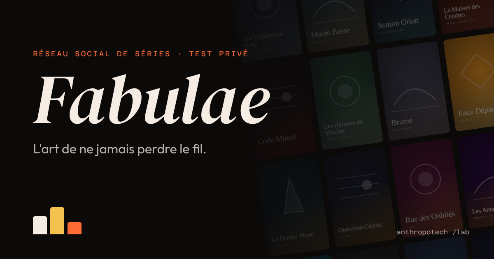

# Fabulae, page de présentation

**L'art de ne jamais perdre le fil.**

Une série conseillée à la machine à café, oubliée le soir même. Trois saisons dévorées, et personne autour de vous pour en parler. Fabulae garde le fil : ce que vous regardez, ce que vous avez aimé, ce que vos proches recommandent.

Ce dépôt contient la page de présentation de Fabulae, réseau social de séries. L'application est en test privé, sur invitation.

  
  

## Ce que présente la page

| Rubrique | Contenu |
|:--|:--|
| Le classement | Le Top 3 de vos séries du moment, et le Flop 3 des séries que vous ne recommandez pas |
| Classer | Une série en dix secondes : 4 statuts (à voir, en cours, terminée, abandonnée), une note sur 5 étoiles, un avis |
| La communauté | Le fil, le profil, la fiche série, la bibliothèque et les tendances |
| Découverte | Des suggestions avec un taux de compatibilité calculé d'après les genres aimés, ou non |
| Données | Aucune publicité, bibliothèque publique ou privée, suppression du compte sans délai |

## Vos données

- Aucune donnée vendue ni utilisée pour de la publicité.
- Bibliothèque publique ou privée, au choix de chaque membre.
- Signalement d'un profil en deux gestes, suppression du compte depuis le profil, avec confirmation.
- Comptes et bibliothèques hébergés par Supabase, dans l'Union européenne.
- Droits d'accès, de rectification, de suppression et de copie des données, sur simple demande.

## Principes de la page de présentation

- Aucun cookie, aucun traceur, rien d'enregistré dans le navigateur.
- Séries, affiches et membres montrés sur la page entièrement fictifs.
- Page non référencée par les moteurs de recherche.

## Crédits

Les informations sur les séries proviennent de TMDB. Fabulae utilise l'API de TMDB, sans être approuvé ni certifié par TMDB.

## Technique

Page statique en HTML, CSS et JavaScript, sans dépendance, hébergée sur GitHub Pages. Polices DM Serif Display, Outfit et Azeret Mono sous licence SIL Open Font License 1.1 (voir `fonts/OFL.txt`).

---

Fabulae, projet d'Anthropotech Lab. Conçu et développé par Shams &amp; Dean. 
© 2026 Shams Guettaf, Anthropotech Lab. Tous droits réservés. Voir <a href="LICENSE">LICENSE</a> et les <a href="https://shamsetdean.github.io/fabulae-presentation/mentions-legales.html">mentions légales</a>.
